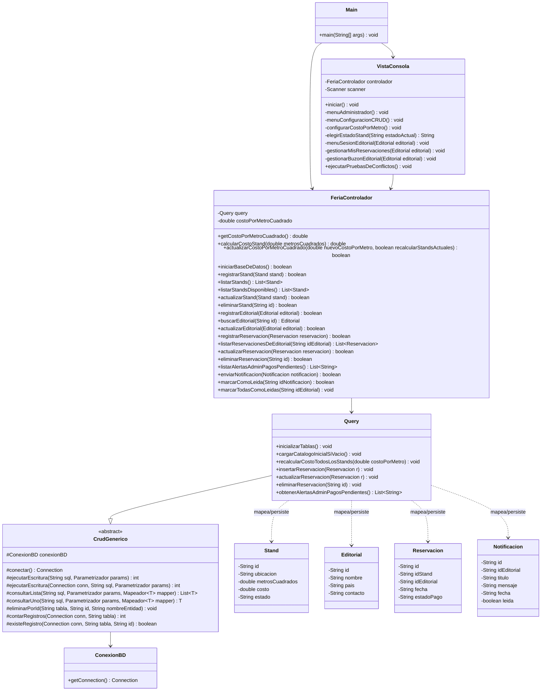

# Diagrama de Clases — Arquitectura MVC y Capa de Datos

## 1. Descripción Estructural
El sistema separa las entidades de dominio (`modelo`), la persistencia y transaccionalidad (`bd`), la lógica de coordinación y tarifa por $m^2$ (`controlador`), y la interacción por consola (`vista`).

## 2. Diagrama de Clases (Mermaid)

