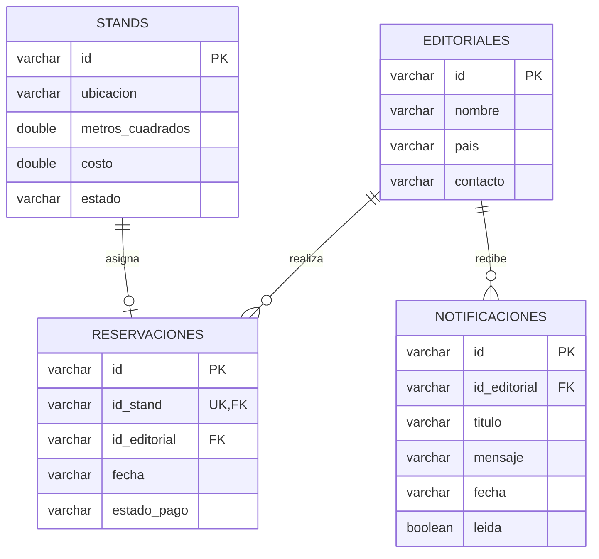

# Modelo Entidad-Relación — Base de Datos Relacional

## 1. Tablas y Restricciones
* **`stands`:** `id` (PK), `ubicacion`, `metros_cuadrados`, `costo`, `estado` (`Disponible` / `Reservado`).
* **`editoriales`:** `id` (PK), `nombre`, `pais`, `contacto`.
* **`reservaciones`:** `id` (PK), `id_stand` (FK -> `stands.id`, `UNIQUE`), `id_editorial` (FK -> `editoriales.id`), `fecha`, `estado_pago` (`Pagado` / `Pendiente`).
* **`notificaciones`:** `id` (PK), `id_editorial` (FK -> `editoriales.id`, `ON DELETE CASCADE`), `titulo`, `mensaje`, `fecha`, `leida`.

## 2. Diagrama Entidad-Relación (Mermaid)

