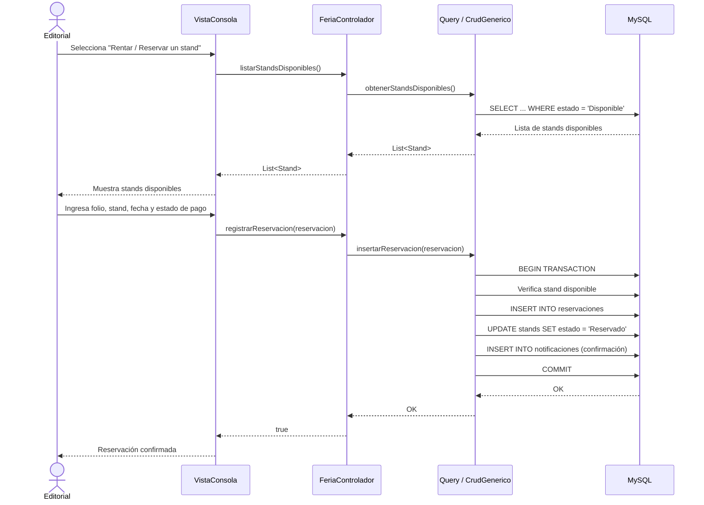

# Diagrama de Secuencia — Renta y Gestión de Reservaciones

## 1. Flujo Principal
Representa la interacción entre `VistaConsola`, `FeriaControlador`, `Query` (heredando de `CrudGenerico`) y la base de datos al rentar o actualizar una reservación de stand.

## 2. Diagrama de Secuencia (Mermaid)

